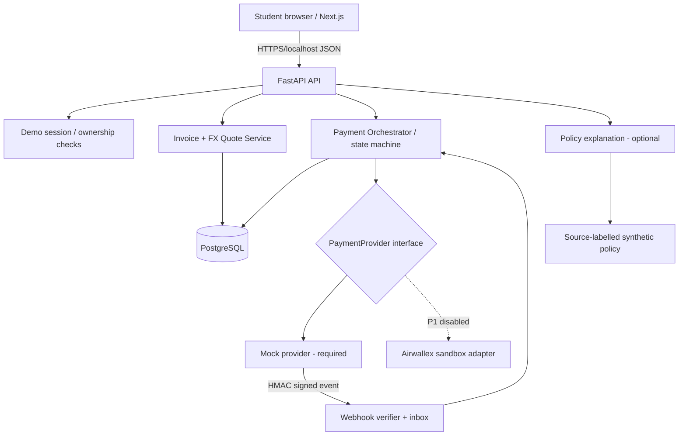

# 02 — Architecture and boundaries



## Backend modules suggested

`app/core/config.py`, `app/api/`, `app/domain/` (state machine, money), `app/models/`, `app/schemas/`, `app/services/` (quote/payment/provider), `app/providers/base.py`, `app/providers/mock.py`, `app/webhooks/`, `app/seed.py`.

## Provider abstraction

```python
from typing import Protocol
class PaymentProvider(Protocol):
    async def create_payment(self, *, order_id: str, amount_minor: int, currency: str, idempotency_key: str) -> dict: ...
    async def verify_webhook(self, *, raw_body: bytes, headers: dict[str, str]) -> dict: ...
    async def get_payment_status(self, provider_payment_id: str) -> str: ...
```

This is an interface sketch, not an Airwallex request schema. P0 only implements mock. Keep provider event statuses separated from internal order statuses through a deliberate mapper.

## No hidden cross-border assumption

`CNY -> VND` is a **quote representation in a sandbox**, not an actual transfer corridor. A single provider's checkout/collection API is NOT a payout/remittance API. University/insurer merchant onboarding and payout use case eligibility would have to be validated for a real product.

## Ownership + auth

Create a local **demo student** and **demo operator** account. The operator role requires a server-validated local code from `DEMO_OPERATOR_CODE`; never issue operator roles based on client role alone. Login route issues a short-lived signed session token with role; use HttpOnly cookies if practical, plus CSRF controls for state-changing cookie-based calls. Alternatively bearer token kept only in memory. All invoice/order endpoints filter by authenticated user; operator simulation restricted to demo only. No unauthenticated `X-Demo-User` shortcut.

## Consistency strategy

- Use PostgreSQL transactions and `SELECT ... FOR UPDATE` on order state transitions.
- Store raw webhook hashes and sanitized event metadata. Unique `external_event_id`; idempotent duplicate acknowledgement.
- Enforce monotonic terminal states (do not overwrite success with failure, etc.).
- Persist consent and quote snapshot on the order so exchange rate/amount cannot mutate after confirmation.
- Receipt generated server-side with all identifiers and a visible simulated watermark.
