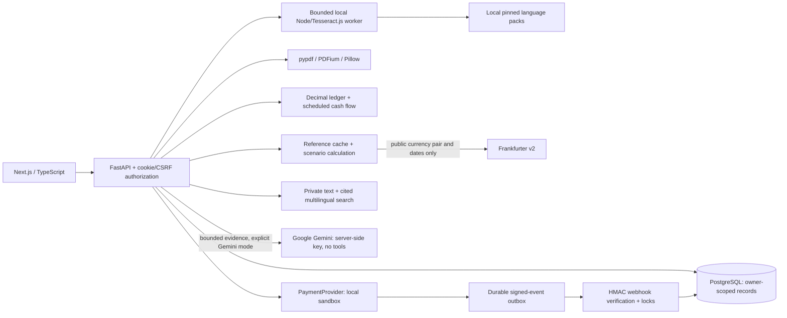

## Combined RAG generation amendment — 19 October 2026

The knowledge-page primary question flow is retrieve -> binary consent -> Gemini synthesis -> original citations. Refusal dispatches no question; server lookup remains. Scope, session/revision/expiry and post-generation source checks are retained. The default model is 3.5 Flash-Lite; a distinct configured alternate is attempted at most once for transient/unavailable-model errors, with an 8s first-attempt cap and the same 25s total deadline. No auth/quota/bad-input/invalid-output retries. A question may make up to two requests to the fixed Google host; responses identify the actual model. Existing no-payment/no-claims-decision controls remain. Exact validation: current IMPLEMENTATION_REPORT.md. This supersedes older default-mode/provider statements below.

# Managed Topic D RAG architecture amendment — 19 October 2026

Admin account -> draft ingestion (authored text or local PDF/OCR) -> page-preserving chunks and persistent BM25 terms -> local draft preview -> explicit publication -> authenticated student question -> prefiltered current/published corpus -> up to three cited excerpts -> optional consent-gated Gemini generation -> post-call permission/source revalidation -> source reader/download with revision and SHA-256. Private account documents and claim files remain separate. Existing reviewed portfolio comparison and claims preparation continue at /insurance, now linked to /knowledge. The copilot can fill unused document-context slots from published sources without exceeding its three-excerpt consent bound.

New tables: rag_documents, rag_chunks, rag_revisions; additive User.is_rag_admin flag. Migration 73c9794e8f35. No additional paid service, vector extension or model download is required. Admin CRUD/publication routes are under /api/v1/admin/rag; reader/ask/preview under /api/v1/rag. Reproducible contract: contracts/rag.openapi.json. Method, primary sources, regression evaluation and explicit limits: docs/22_TOPIC_D_MANAGED_RAG.md. Exact results: current IMPLEMENTATION_REPORT.md. Earlier sections below are historical.

# Current permission UX amendment — 19 October 2026

Feature-triggered native dialogs now offer only Agree / Disagree and a purpose-specific details hyperlink. Gemini uses the fixed server SAMPLE_ASSISTANT preset; no scope checkboxes. Old v1 AI grants are invalidated. Each document/OCR/claim upload asks separately and the API verifies its purpose/version processing acknowledgement. Decline cancels the browser request. AI grant expiry, revision, session isolation and revocation remain enforced. The sample preset excludes personal-source documents even in paid mode. This does not claim legal certification, device permissions or cryptographic proof of a click. Current exact validation is in IMPLEMENTATION_REPORT.md and binary-consent-* evidence. Earlier sections below describe previous releases.

## Current optional-AI permission boundary (19 October 2026)

`backend/app/privacy.py` and `ai_permissions` enforce session-scoped, revisioned and expiring grants. Assistant requests carry `privacy_revision`; the server determines allowed evidence. Default `DEMO_ONLY` never exports personal finance or policy summaries and filters document provenance before retrieval. Private-mode configuration is not a legal/billing verification. Claim data stays out of model context. The UI defaults to direct lookup, supports selective permission, local preview and revocation; Enter sends and Shift+Enter adds a newline. Public privacy notice, upload disclosures and all-device logout complete the user controls. See docs/21_PRIVACY_PERMISSIONS_RESEARCH.md for tier mapping, sources, threat cases and limits.

# Demo — Student Finance Participant MVP

Current implementation, 2026-10-19. The user clarified their screenshot as competition-problem analysis and requested a working upgrade along that analysis. The team retains the official Topic C/D submission choice; no competition submission was performed. The Free Render demo is now live at https://ai4s-demo.onrender.com; exact verification and limits are in IMPLEMENTATION_REPORT.md.

## End-to-end task

A student uploads a fee notice (photo, scan, text PDF or text). Local OCR/text extraction proposes invoice number, issuer, recipient, CNY amount and due date with page/line evidence. The student checks and edits the fields, explicitly confirms review, then saves. The original remains privately downloadable. Saving creates neither a ledger entry nor a payment.

A user-declared CNY/VND ledger records actual income/expenses by original currency. Scheduled items can be entered manually or copied from an owned invoice. A 30/60/90-day projection highlights negative balances and overdue items. Explicit confirmation posts an occurrence once; retries do not duplicate it or double-count it in the forecast. Voiding restores its balance effect and planned occurrence.

Frankfurter supplies dated daily CNY/VND references and history. The scenario tool computes reference and ±5% costs against an optional VND budget. This is sensitivity analysis, not a market prediction or executable conversion price. The student copilot routes budget, invoice, FX and policy questions to owned data/citations and opens the relevant workflow. It now offers optional Gemini generation over bounded owner-scoped evidence and recent conversation, alongside the deterministic direct-lookup workflow. No assistant response executes financial actions. See GEMINI_GUIDE.md for payload limits, provider setup, privacy and actual acceptance evidence.

## Guided acceptance and provider test methods

`/test-lab` provides 15 self-authored upload inputs, source links for independently published documents, server readiness and progress derived from owned records. Users can select SUCCESS or DECLINED before exact-quote consent. Confirmation records the chosen method and atomically creates one delayed provider-outbox event; a worker sends the signed callback after three seconds. The callback remains the only authority for terminal outcome and receipt issuance. MANUAL remains available for advanced operator/replay tests; its privileged endpoints still require a separate server-validated operator code. A disabled worker rejects automatic methods before creating an intent.

Uploaded documents declare USER_PROVIDED, PUBLIC_REFERENCE or TEST_FIXTURE. A public reference requires its original source URL; this metadata is not issuer verification or proof of insurance. The original BFSU 2025 comparison PDF was actually uploaded, OCR-processed, searched with page/source citations and downloaded byte-for-byte. Its original is fetched separately rather than bundled as team-owned content.

An owner-only `/orders/{id}/evidence` download exports the reviewed original, quote, consent, signed-event history, receipt when eligible and linked plan/ledger snapshot. It excludes authentication credentials. The user is told the ZIP can contain their private source document. `scripts/team.py` supplies setup, diagnostics, foreground startup with an optional precompiled production UI, original-reference download and secret-free source packaging with per-file checksums. The same-origin proxy allows 120 seconds so the bounded 75-second OCR process can return its result or structured error. Production startup uses the supported Webpack builder; advanced operator UI remains development-only.

## Architecture

Backend: FastAPI/Pydantic v2, SQLAlchemy 2, PostgreSQL, Alembic, Argon2id, opaque hashed session tokens and HttpOnly cookies. Next.js proxies `/api/v1` on the same origin for localhost/LAN. Static revision `9f40f776cbf8` adds finance/import tables; additive revisions `20261018_self_service` and `20261018_document_kind` preserve records and add provider scheduling/scenario and declared document provenance: 18 ORM tables and 50 current OpenAPI paths. Contract: `contracts/openapi-mvp.json`.

## Core algorithms and boundaries

- Tesseract.js 6.0.1 performs actual neural OCR in a local worker. English, Vietnamese and Simplified Chinese models are pinned to commit `87416418657359cb625c412a48b6e1d6d41c29bd`. The UI supports selecting the main language. Label parsing normalizes separators and date/CJK spacing, retains source lines, and leaves missing fields for review. Recognition does not certify an institution or payee.
- Ledger amounts remain Decimal/string values. CNY supports two fractional places; VND none. Base-currency valuation is a separate dated view and does not transfer or offset funds. Browser numbers are used only for graph geometry.
- Forecast starts with declared balances and actual posted entries, adds unconfirmed scheduled occurrences, and groups overdue items on day one. Monthly recurrence clamps to month end while preserving the original day for later months. This is not a statistical spending/FX model.
- Owner locks, request hashes, idempotency keys and a posted plan-occurrence partial unique index prevent duplicate posting. Original and voided records remain auditable. Invoice-derived plans are labelled snapshots, not automatically synchronized with later edits.
- Assistant routing reads only the authenticated user's data. Policy replies contain original excerpts/pages or missing-evidence text. Document content is data, never executable instructions. The assistant returns an empty `executed_actions` list.
- Import review, actual-entry posting and payment consent are separate user actions. No model output, redirect or client status can mark payment success. The sandbox retains signed asynchronous events, timestamps, amount checks, durable outbox delivery and terminal locks.

## Integrations and evidence

Frankfurter v2 is the actual no-key public API: https://frankfurter.dev/ . Private invoices, documents and identity are not sent upstream. OCR uses local models after one-time public downloads; the API host needs Node.js and installed frontend Node packages. Pillow/pypdfium2 retain their native runtime notices. Lock files record dependencies; `evidence/ocr-model-manifest.json` records language source/hashes.

Verified: 112 backend tests, 15 full browser workflows through LAN, frontend lint/optimized TypeScript/build, and 11 current actual-HTTP acceptance checks, including an original public BFSU PDF, source-byte integrity, signed automatic provider outcomes, separate ledger confirmation and owner case export. Earlier OCR smoke results are retained as limited synthetic-fixture evidence. Three clean self-authored printed samples matched 5/5 expected fields per language; this is not a production accuracy estimate. Exact timings and fixes are in IMPLEMENTATION_REPORT.md and evidence/.

## Limits and reproduction

No production custody, bank synchronization, real transfer, insurance activation, realtime FX feed, vector-based semantic retrieval, claims filing or statistical forecasting is connected. Forecasts depend on declared inputs. OCR can fail on photos, handwriting and complex layouts; review is required. Payment remains MOCK, demo mode, with real payments disabled.

Follow TEAM_HANDOFF.md for current Windows/Unix setup and ACCEPTANCE_TESTS.md for the A-Z journey. Fresh extraction, clean installation, production build and both owner browser flows were exercised on isolated ports/database; see evidence/handoff-validation.json. STUDENT_FINANCE_GUIDE.md explains the broader finance screens. Install locked backend dependencies, run `npm ci`, migrate, and execute `python scripts/setup_ocr.py` once. Start database/API/frontend, then pytest and Playwright. `scripts/check_acceptance_live.py --public-reference .local/public-reference/bfsu-2025.pdf` produces current credential-free owner evidence. LAN IP 192.168.1.14 may change with DHCP; keep the host awake. Windows/native PostgreSQL was exercised; Docker/Unix startup was documented, not executed here.

## Free cloud deployment preparation

The root render.yaml creates one Free Docker web service and one Free PostgreSQL database in Singapore. The cloud image builds Next standalone and includes local OCR models/dependencies. A supervisor normalizes the platform PostgreSQL URL for psycopg, requires explicit cloud secrets and an exact HTTPS origin, enables Secure cookies, migrates without resetting records, starts a loopback-only API and serves UI on the assigned public port. Cloud OCR concurrency is limited to one; local default remains two.

The Free database expires after 30 days; the web service sleeps on idle and has limited CPU/RAM/quotas. Full Linux Docker/Render execution and cloud capacity must be checked on an authenticated account; local build/schema checks alone are not evidence of a live site. See DEPLOY_RENDER.md and evidence/cloud-readiness.json for actual checks and connection status. No paid resource is authorized.

## Public deployment verification

The user created the Render Blueprint; runtime commit 3ac84b1 reached Live and passed 10 actual HTTPS core check groups. The public sign-in UI was inspected. The dense original BFSU scanned table returned HTTP 422 OCR_TIMEOUT at the configured 75-second bound; its native success is not proof of Free-host capacity. No paid upgrade was made. See evidence/render-live-http.json, render-public-reference.json and cloud-readiness.json.

## Combined C+D insurance journey — 19 October 2026

The reviewed portfolio feeds explicit coverage comparison, native-currency premium planning and the existing human-consent sandbox. Cases preserve creation-time policy snapshots, original attachment hashes and a revision-controlled journal. Checklist and file edits invalidate readiness. External submission is a user-reported event, with no insurer network call or approval. Exact source excerpts must occur on the declared page; their interpretation remains human reviewed. No annual limits are combined or presented as guaranteed claim payouts. See `docs/20_TOPIC_C_D_RESEARCH_AND_IMPLEMENTATION.md`, `contracts/insurance.openapi.json`, `TOPIC_C_D_GUIDE.md` and `scripts/check_insurance_live.py`. The product combines both task families; official registration still chooses one topic.
