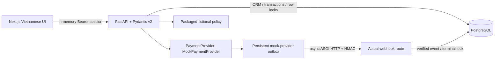

# Insurance Cross-border Payment Assistant — Technical documentation

Prototype: local FastAPI + Next.js + PostgreSQL, zero real funds. Official Topic C or D remains undecided; the implementation does not register or select a competition topic.

## Problem and implemented journey

A Vietnamese student preparing to study in China needs to understand a foreign-currency insurance invoice, review fees, and track a payment request without being misled about insurance activation. This prototype uses a wholly fictional institution and beneficiary. The student opens an 800.00 CNY synthetic invoice, obtains a persisted fixed-rate VND quote, reviews the fee breakdown and expiry, and confirms manually. A separate authenticated local operator requests a mock-provider outcome. A persistent provider outbox emits a signed asynchronous event to the webhook route. The student sees processing, verified simulated success/failure, history, event trace and a printable simulation receipt. A receipt is never proof of insurance or money settlement.

## Verified architecture

`backend/app/main.py` implements API semantics and role gates. `models.py` defines SQLAlchemy 2 ORM with constraints and indexes. Static versioned Alembic migration `4ad8203419ab` deploys ten tables: users, invoices, quotes, orders, idempotency records, transactions, events, receipts, audit logs and provider outbox. `services.py` calculates and serializes money/time; `providers.py` is the mock adapter and durable dispatcher; `webhooks.py` verifies and applies provider events. Frontend uses App Router, TypeScript and Tailwind/CSS with no remote fonts/assets. Backend response DTOs whitelist public fields. Errors carry code/message/request ID.

## Algorithms and consistency

- All monetary math uses Decimal. For 800 CNY × 3,500: principal 2,800,000 VND. ROUND_HALF_UP on the 1.5% fee gives 42,000 VND; fixed 5,000; total 2,847,000. VND has no fractional minor unit. JSON money is a string; frontend formats integers with BigInt, never calculates totals.
- Quote expiry is checked at create and confirm. Quote ID and optional expected total bind manual consent to the review screen. Consent records actor, time and `demo-v1`. Expired awaiting orders are closed when read or before creating a new quote/order.
- State machine: awaiting → processing/cancelled/expired; processing → succeeded/failed. No terminal reversal. An active/succeeded partial unique index prevents a second active payment for an invoice.
- User row locks serialize create/confirm with persisted `(user, operation, key)` uniqueness, request digest and exact original response snapshot. Order row locks protect provider transitions. A transaction permits one provider attempt per order. Mock intent IDs are deterministic by order ID.
- HMAC-SHA256 covers `timestamp + '.' + raw_body`. Constant-time signature comparison precedes parsing. Delivery timestamps allow ±300 seconds. Provider payment ID, order, VND amount and currency must match persisted intent. Events before intent creation/future event time are ignored. Unique event ID plus advisory transaction lock makes concurrent duplicate delivery safe. Altered content under the same event ID is rejected.
- Verified mismatch/reversed/duplicate events leave safe evidence. Success creates one unique receipt in the same transaction. Worker retries persisted outbox deliveries after restart; duplicate delivery cannot duplicate receipt. Webhook SQL executes in a threadpool so a synchronous database lock cannot block the ASGI event loop.

## Read-only guidance

`/assistant` has three deterministic source-labelled FAQs backed by `fixtures/demo_policy.md`. It labels the policy fictional and refuses unspecified benefit/claims questions with “Insufficient policy information”. It is not a general chatbot or a retrieval/LLM system. No AI can consent, confirm, emit provider events or modify totals. Airwallex is deliberately unimplemented and disabled; enabling it is rejected rather than pretending to support an unverified insurance corridor.

## Validation and practical limits

See `../IMPLEMENTATION_REPORT.md` and `evidence/` for exact final executions and screenshots. Tests use a separate PostgreSQL database, including concurrent creation/confirmation/webhooks. Browser checks cover desktop/mobile, keyboard activation, consent, operator authentication, success, duplicate delivery, cancellation, retry, failure and printable receipt. No load test or P95 claim is made. Docker/Unix paths are documented but not executed on this Windows host. Security limitations and dependency audit findings are in `SECURITY_SELF_ASSESSMENT.md`.

## Documentation references

- FastAPI: https://fastapi.tiangolo.com/ (local generated `/docs` also reflects the implementation).
- Pydantic: https://docs.pydantic.dev/latest/
- SQLAlchemy transactions: https://docs.sqlalchemy.org/en/20/orm/session_transaction.html
- PostgreSQL row locks: https://www.postgresql.org/docs/current/explicit-locking.html
- Alembic: https://alembic.sqlalchemy.org/en/latest/
- Next.js App Router: https://nextjs.org/docs/app (installed version guides were also read in `node_modules/next/dist/docs/`).
- Original research sources and synthetic assumptions: `../docs/09_SOURCES_AND_ASSUMPTIONS.md`. Organizer/provider claims there are inherited research, not revalidated registration or legal advice in this implementation.
